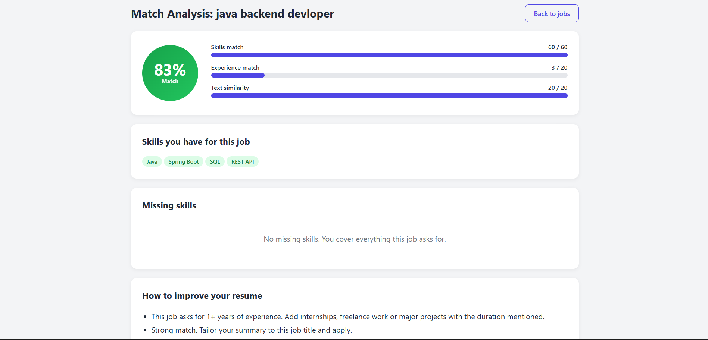
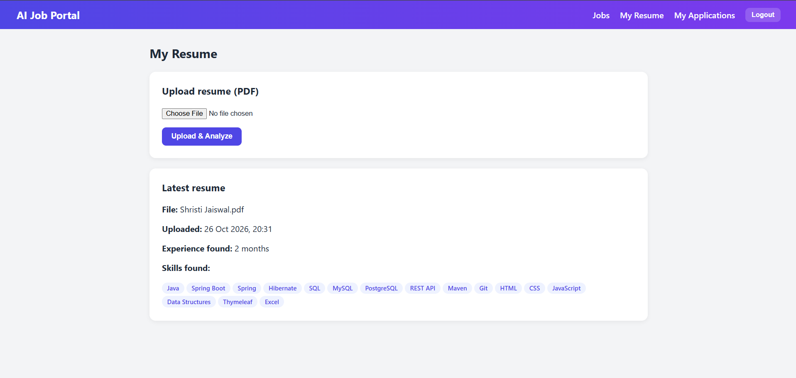
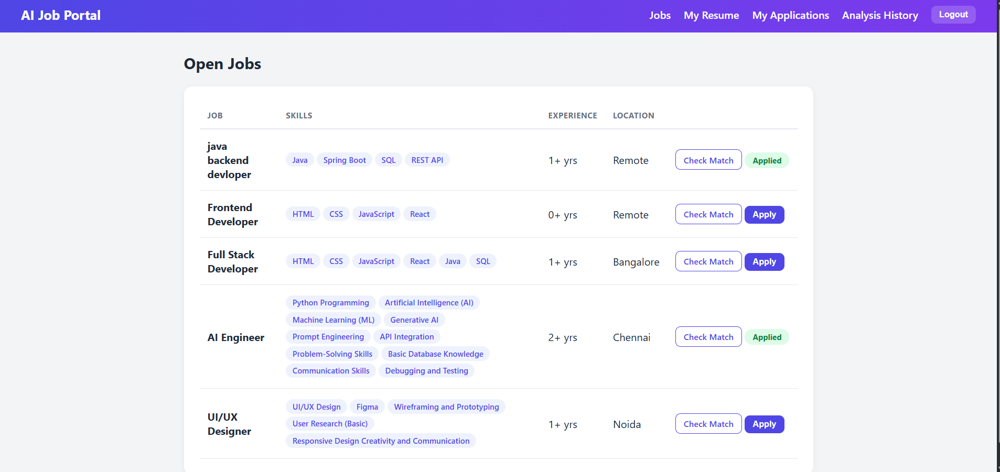
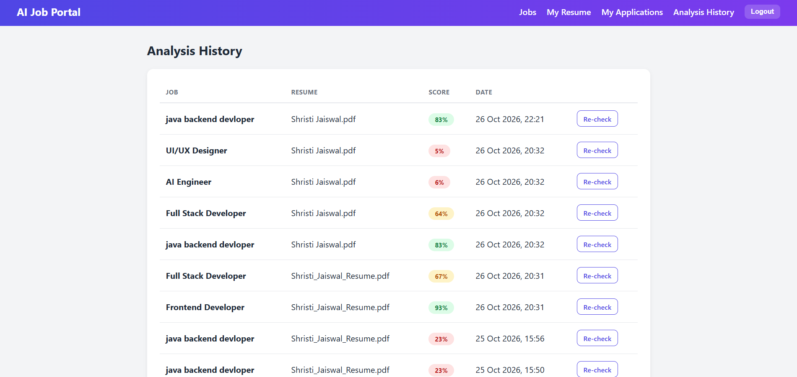
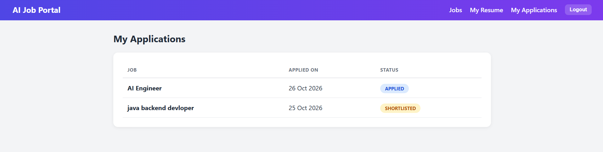
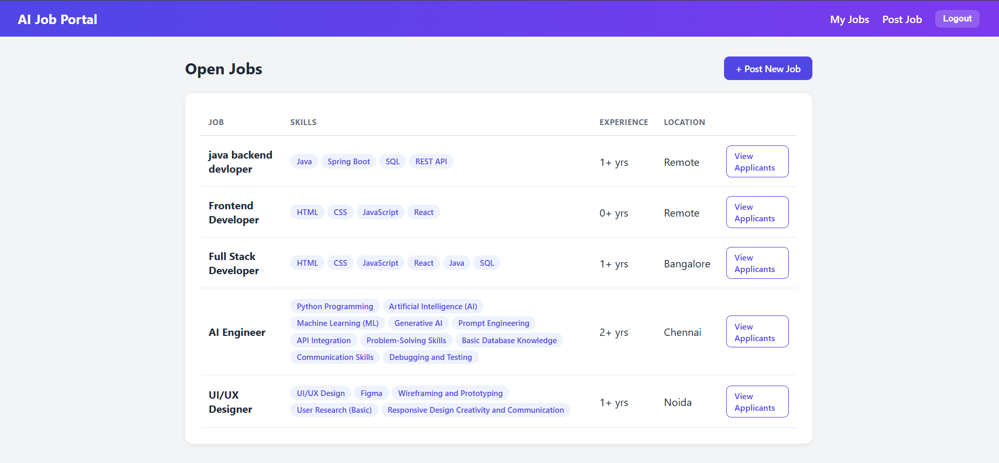
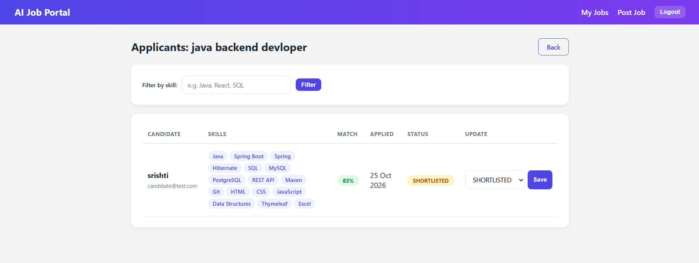
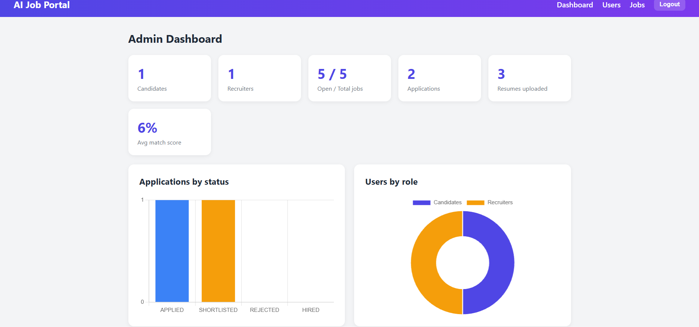
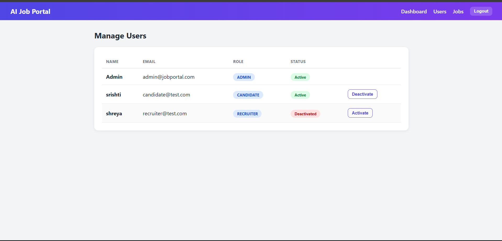
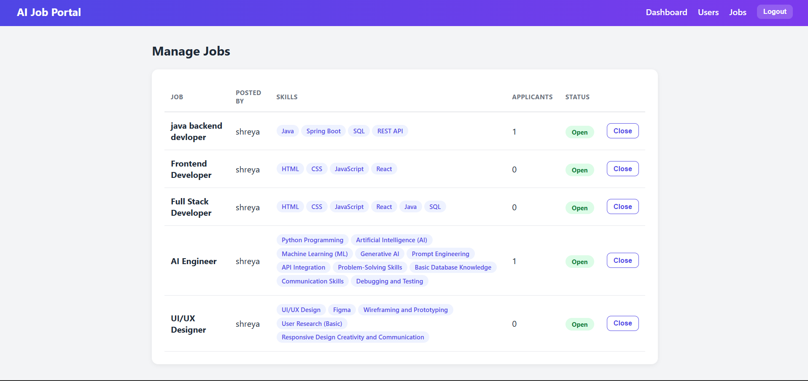

# AI-Powered Job Portal & Resume Analyzer

A full-stack job portal built with **Java and Spring Boot** where candidates upload a PDF resume and the system analyzes it against each job: it extracts skills and experience, generates an **explainable match score**, lists **missing skills**, and gives **resume improvement suggestions**. Recruiters post jobs and review applicants ranked by match score. Admins manage users and jobs and see platform statistics.

> Demo project built from scratch. The "AI" here is a transparent, rule-based NLP pipeline (skill dictionary + cosine similarity), not a black box, so every score can be explained.

## Screenshots

### Candidate

**AI Match Analysis**: skills match, experience match aur text similarity ke basis pe resume score


**Resume Upload & Skill Extraction**


**Open Jobs** (Check Match / Apply)


**Analysis History**


**My Applications**


### Recruiter

**Job Listings**


**Applicants with AI Match Score** (skill filter + status update)


### Admin

**Dashboard**


**Manage Users**


**Manage Jobs**


## Features

### Candidate
- Sign up and log in
- Upload a PDF resume; skills and experience are extracted automatically
- Job recommendations sorted by match score (best match first)
- "Check Match" on any job: score breakdown, matched skills, missing skills, improvement suggestions
- Analysis history, to see how the score changes after improving the resume
- Apply to jobs and track application status (Applied, Shortlisted, Rejected, Hired)

### AI Resume Analyzer
- PDF text extraction (Apache PDFBox)
- Skill extraction using a dictionary with aliases (for example `js` maps to JavaScript, `postgres` to PostgreSQL)
- Experience extraction from date ranges such as "June 2026 - Present" and phrases such as "2 years"
- Job vs resume comparison with an explainable score (see below)
- Rule-based suggestions: missing skills, experience gap, measurable results, resume length, GitHub/LinkedIn links

### Recruiter
- Post jobs with required skills and minimum experience
- View applicants ranked by match score
- Filter applicants by skill
- Update application status

### Admin
- Dashboard with totals, average match score and charts (Chart.js)
- Activate or deactivate users
- Close or reopen job listings

## How the match score works

Every score is out of 100 and shown with its breakdown:

| Component | Marks | How it is calculated |
|---|---|---|
| Skills match | 60 | `60 x (required skills found in resume / total required skills)` |
| Experience match | 20 | `20 x min(candidate months, required months) / required months` |
| Text similarity | 20 | Cosine similarity between resume text and job text (term frequency, stop words removed) |

Example: `Skills 30/60 + Experience 7/20 + Similarity 4/20 = 41%`

## Tech stack

| Layer | Technology |
|---|---|
| Backend | Java, Spring Boot 4 (Web, Security, Data JPA, Validation) |
| Frontend | Thymeleaf, HTML, CSS, Chart.js |
| Database | PostgreSQL |
| PDF parsing | Apache PDFBox 3 |
| Auth | Spring Security (session login, BCrypt, role-based access: CANDIDATE, RECRUITER, ADMIN) |
| Build | Maven |

## Project structure

```
com.jobportal
 |- analyzer     PdfTextExtractor, SkillExtractor, MatchScoreCalculator,
 |               SuggestionEngine, AnalyzerService
 |- config       SecurityConfig, CustomUserDetailsService, DataSeeder
 |- controller   Auth, Candidate, Recruiter, Resume, Analysis, Admin
 |- entity       User, Job, Application, Resume, ResumeAnalysis, Role, ApplicationStatus
 |- repository   Spring Data JPA repositories
```

## Database

Tables are created automatically by Hibernate:
`users`, `jobs`, `applications`, `resumes`, `resume_analyses`

## Run locally

**Requirements:** JDK 17 or newer, Maven (or the included `mvnw`), PostgreSQL.

1. Clone the repository
   ```bash
   git clone https://github.com/srishtijaiswal077-code/jobportal.git
   cd jobportal
   ```
2. Create a PostgreSQL database
   ```sql
   CREATE DATABASE jobportal;
   ```
3. Create `src/main/resources/application-local.properties` (this file is git-ignored) with your own credentials
   ```properties
   spring.datasource.url=jdbc:postgresql://localhost:5432/jobportal
   spring.datasource.username=YOUR_DB_USER
   spring.datasource.password=YOUR_DB_PASSWORD
   ```
4. Start the app
   ```bash
   ./mvnw spring-boot:run
   ```
5. Open `http://localhost:8081`

### Demo credentials

| Role | Email | Password |
|---|---|---|
| Admin | `admin@jobportal.com` | `admin123` |

Candidate and recruiter accounts are created from the Register page. These credentials are for local demo only; change them before any real deployment.

## Try the full flow

1. Register a **recruiter** and post a job (for example skills: `HTML, CSS, JavaScript, React`)
2. Register a **candidate**, upload a text-based PDF resume
3. Open the job list and see the match score and recommendations
4. Click **Check Match** to see the breakdown, missing skills and suggestions
5. Apply, then log in as the recruiter, see the ranked applicant and change the status
6. Log in as admin to see statistics and manage users and jobs

## Known limitations and future work

- Skill detection depends on a fixed dictionary; new skills need to be added to `SkillExtractor`
- Scanned or image-only PDFs are not supported (no OCR)
- Similarity uses term frequency, not full TF-IDF or embeddings
- Optional LLM integration for richer, personalized resume feedback
- Email notifications on status change
- Deployment (Docker + cloud hosting)

## Author

**Shristi Jaiswal**, BCA student and web developer.
Built as a portfolio project.
